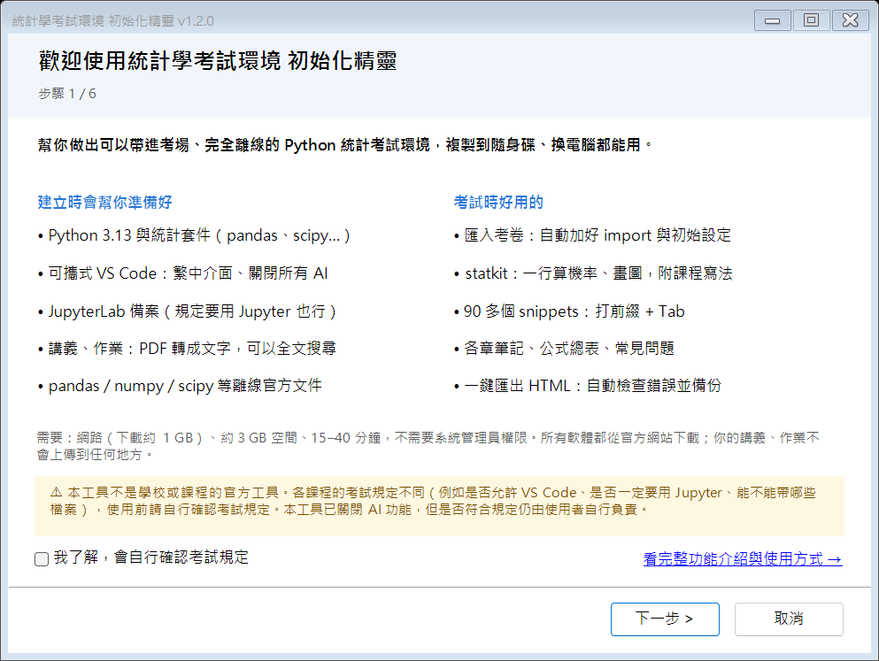
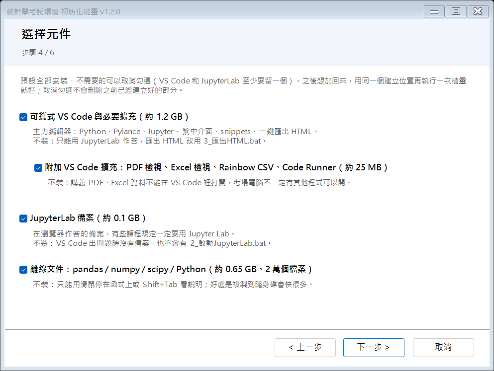

# 統計學考試環境

**一個精靈，幫你做出可以帶進考場、完全離線使用的 Python 統計考試環境。** 全部放在一個資料夾，複製到隨身碟、換電腦都能用；裡面除了 Python 和編輯器，還有考試時用得到的工具、筆記和公式表。



> ⚠ **這不是學校或任何課程的官方工具。** 各課程的考試規定不同（是否允許 VS Code、是否一定要用 Jupyter、能帶哪些檔案），使用前請自行確認。本工具已關閉 AI 功能，但是否符合規定由使用者自行負責。

> ⚠ 要確認是否能使用 VS Code 以及自己寫的套件，如果最後不能用，我會再進行修改。如果有任何問題歡迎開 issue 或直接跟我說。

想直接開始：跳到[快速開始](#快速開始)。

## 為什麼需要它

開書上機考通常是**全程斷網、禁止 AI、只能用隨身碟裡的環境**。自己準備的話，常見的狀況是：

- 考試時才發現少裝一個套件，沒有網路也裝不了
- 圖表的中文變成方塊
- 隨身碟換到考場電腦，磁碟代號不同，路徑全部壞掉
- 新版 VS Code 內建 Copilot 等 AI 功能，不確定有沒有關乾淨
- 斷網查不到 pandas / scipy 的文件
- 寫完匯出 HTML 才發現有錯誤、執行順序亂掉，或圖片沒出來

這個工具把這些都先處理好：你只要照著精靈點下一步，最後把資料夾複製到隨身碟。這是為某一門統計學課設計的，其他使用 Python / Jupyter 的統計課程也可以直接用或改來用。

## 建立時會幫你準備好什麼

| 項目 | 說明 |
|---|---|
| Python 與套件 | WinPython 3.13，加上 numpy、pandas、scipy、matplotlib、seaborn、statsmodels、sympy、openpyxl 等統計課會用到的套件 |
| 可攜式 VS Code | 繁體中文介面，裝好 Python、Pylance、Jupyter 等擴充；**移除內建的 Copilot、關閉所有 AI 功能**；可以同步你自己電腦上的字體大小、快捷鍵（AI 相關設定一律排除） |
| JupyterLab | 備案編輯器，在瀏覽器裡作答；考試規定要用 Jupyter 也沒問題 |
| statkit | 這個 repo 自己寫的工具，見下面「考試時好用的功能」 |
| 筆記與公式總表 | 讀入資料與整理、公式總表、Markdown 與 LaTeX 語法、視覺化、敘述統計、機率與離散分布、連續分布、常態與模擬，每一本都可以直接執行、複製 |
| 你的講義與作業 | 選你自己的資料夾放進去；講義 PDF 會轉成文字，在 VS Code 按 Ctrl+Shift+F 就能全文搜尋 |
| 離線文件 | pandas、numpy、scipy、Python 官方文件，斷網也能查 |
| 中文字型 | 圖表的中文不會變方塊 |
| 啟動檔 | 雙擊就能用：啟動 VS Code、啟動 JupyterLab、匯出 HTML、環境檢查、匯入考卷 |

全部用**相對路徑**，換磁碟代號、換電腦都不用重新設定；也**不會讀到考場電腦上的套件**。不需要系統管理員權限，不會改系統設定。哪些部分要裝可以在精靈裡勾選（例如不要離線文件，複製到隨身碟會快很多）。

## 考試時好用的功能

**匯入考卷**：考試時老師給一份 ipynb，雙擊 `5_匯入考卷.bat` 選它，就會複製到 `exam\`（保留原檔名）、在標題下面加好 import 與初始設定，再用 VS Code 打開。考卷用到的資料檔如果跟考卷在同一個資料夾，會一起複製過去。不會蓋掉你已經在寫的同名考卷。

**statkit**：一行算出答案，還會印出**課程寫法的程式碼**，可以直接抄進答案。

```python
import statkit as sk

sk.prob(sk.Poisson(6.6), 'X >= 10')    # 離散分布的 ≥ 會自動改成 1 - F(9)
# Pr(X ≥ 10) = 1 - F(9) = 0.1314
# 程式碼：print(round(1 - stats.poisson.cdf(k=9, mu=6.6), 4))

sk.describe(df['Food'])                # 平均、中位、四分位（講義的算法）、變異數、偏態…，每一項附寫法
df = sk.peek('檔名.xlsx')              # 看工作表、欄位型態、缺值、前幾列，並印出讀檔程式碼
sk.describe_by(df, 'Food', by='Region')   # 依類別分組比較；sk.corr_matrix 相關矩陣（plot=True 熱圖）

W = 6 + 2 * sk.Normal(50, 6) + 3 * sk.Normal(20, 2)   # 獨立常態的線性組合，結果還是常態；W.explain() 看算式
sk.Normal(80, 10).sample_mean(4).P('X <= 75 or X >= 85')   # 樣本平均數偏離 μ 的機率（兩邊）
sk.sample_size(sigma=10, margin=2, prob=0.95)        # 最小樣本數
sk.joint([[0.1, 0.2, 0.2], [0.2, 0.2, 0.1]], xs=[0, 1], ys=[1, 2, 3])   # 聯合機率表：Cov、ρ、是否獨立
sk.hist_classes(df['Food'], start=0, width=1, density=True, fit='norm')  # 直方圖疊常態曲線，並印出疊圖寫法
sk.tidy(ax, bar_labels=True)           # 讓圖更好看：去框線、淡格線、千分位、長條標數值
sk.explore()                           # 互動式分布計算機（VS Code 需要網路；斷網請在 JupyterLab 用）
```

其他還有次數分配表、柴比雪夫、離群值（IQR、z 分數）、分組中位數、各種統計圖、常態近似、貝氏後驗（`sk.posterior`）、期望收益（`sk.expect`）、報童模型、模擬等，`sk.help()` 會列出全部。

**90 多個 snippets**：在 VS Code 的 cell 打前綴再按 Tab，例如 `binom` 是二項分布、`xbar` 是樣本平均數的機率、`histfit` 是直方圖疊 pdf、`joint` 是聯合機率表、`ans` 是考卷的作答格式、`tidy` 是讓圖更好看；每個都附參數說明，Ctrl+Space 可以看列表。

**筆記**：除了各章的寫法，還整理了疊圖技巧、讓圖更好看的原則（講義 02b）、敘述統計的陷阱（講義 03c）、聯合機率表、常態的線性組合、樣本平均數與樣本數，公式總表最後有「觀念陷阱」是非題整理。

**匯出 HTML**：Ctrl+Shift+P →「執行工作」→「匯出目前的 notebook 成 HTML」（或雙擊 `3_匯出HTML.bat`）。會先檢查有沒有寫學號、有沒有沒執行的 cell、執行順序和錯誤，圖片直接內嵌在 HTML 裡，並自動備份到 `exam\_backup\`。

**環境檢查**：考前斷網雙擊 `4_環境檢查.bat`，會檢查套件、statkit、中文字型、實際執行並匯出筆記、VS Code 有沒有 AI 擴充。

**筆記與常見問題**：`00_索引.ipynb` 是所有資源的入口；`常見問題.md` 整理了畫面跑掉、圖表重疊、Kernel、匯出、統計常見錯誤（例如離散分布忘了減 1）的解法。

## 考試當天怎麼用

1. 插隨身碟，雙擊 `1_啟動VSCode.bat`
2. 下載老師給的考卷（和資料檔），雙擊 `5_匯入考卷.bat` 選它
3. 先執行標題下面那一格，在開頭的 Name / Student ID 寫上學號姓名，開始作答；每一小題照考卷格式 `print` 出答案（snippet `ans`）
4. 寫完：Ctrl+Shift+P →「執行工作」→「匯出目前的 notebook 成 HTML（先從頭重新執行）」
5. 用瀏覽器打開 HTML 檢查，上傳

## 快速開始

### 方法 A：下載 Setup.exe（最簡單）

1. 到 [Releases](../../releases) 下載最新的 `STAT_EXAM_Setup_vX.Y.Z.exe`
2. 執行。如果出現「Windows 已保護您的電腦」，按「**其他資訊**」→「**仍要執行**」（這個安裝檔沒有付費的數位簽章，所以 Windows 會提醒）
3. 安裝完會自動開啟初始化精靈，照著畫面做就好

安裝檔只有 2 MB，不需要系統管理員權限，只是把精靈放到 `%LOCALAPPDATA%\STAT_EXAM_Setup`；之後可以從開始功能表的「統計學考試環境 初始化精靈」再次開啟。

### 方法 B：下載 zip

1. 本頁上方「**Code** → **Download ZIP**」，解壓縮
2. 雙擊 **`setup.cmd`**

### 方法 C：用 Mac 做隨身碟

只有 Mac 也可以做出**給 Windows 考場用**的隨身碟（內容跟 Windows 版一樣；這不是在 Mac 上考試用的環境）。

1. 本頁上方「**Code** → **Download ZIP**」，解壓縮
2. 雙擊 **`setup_mac.command`**。如果出現「無法打開，因為它來自未識別的開發者」，請在 Finder 對它按右鍵 →「**打開**」；或打開「終端機」，輸入 `bash ` 再把檔案拖進去，按 Enter
3. 照終端機的問題回答（學號姓名、講義與作業、要裝哪些元件、建立位置、要不要複製到隨身碟）
4. **把隨身碟插到任何一台 Windows 電腦，執行一次 `4_環境檢查.bat`**。第一次執行會安裝 VS Code 擴充（不需要網路，約 1 分鐘），並確認環境在 Windows 上都能用

注意：
- 隨身碟要是 **ExFAT**（或 FAT32）格式，Windows 才讀得到。Mac 格式（APFS、Mac OS 擴充格式）的隨身碟，精靈會停下來提醒你；請用「磁碟工具程式」把它清除成 ExFAT（會刪掉隨身碟上所有資料）
- Mac 版不會同步這台 Mac 的 VS Code 設定（Mac 的快捷鍵、字型在 Windows 上不適用），只用考試設定
- 不需要先安裝 Python：精靈會自己下載 [uv](https://github.com/astral-sh/uv)，再用它下載 Python，都放在 `build/downloads` 和 uv 的快取裡，不會改系統設定

### 方法 D：git clone（進階 / 開發）

```powershell
git clone <這個 repo 的網址>
cd statistics-environment
.\setup.cmd                                        # 圖形介面精靈
# 或直接用參數打包：
powershell -ExecutionPolicy Bypass -File build.ps1 -Out D:\STAT_EXAM -StudentId B12345678 -StudentName 王小明 -HandoutsDir D:\講義
```

| `build.ps1` 參數 | 說明 |
|---|---|
| `-Out` | 建立位置（預設 `build\STAT_EXAM`） |
| `-StudentId` / `-StudentName` | 學號姓名（只用來在匯入考卷後提醒、匯出時檢查考卷裡有沒有寫；不給的話，第一次「匯入考卷」時可以輸入） |
| `-HandoutsDir` / `-HomeworkDir` | 講義、作業資料夾（預設是 repo 的 `handouts/`、`homework/`，沒有就略過） |
| `-SkipVSCode` | 不裝可攜式 VS Code（少約 1.2 GB；只能用 JupyterLab 作答） |
| `-SkipExtraExtensions` | 不裝附加的 VS Code 擴充（`config/extensions-extra.txt`：PDF、Excel 檢視、Rainbow CSV、Code Runner） |
| `-SkipJupyterLab` | 不裝 JupyterLab（`requirements-jupyterlab.txt`），也不放 `2_啟動JupyterLab.bat` |
| `-SkipDocs` | 不下載離線文件（少 0.65 GB、2 萬個檔案，複製到隨身碟快很多） |
| `-NoLocalSettings` | 不同步這台電腦的 VS Code 設定 |
| `-CleanDownloads` | 完成後刪除下載快取（約 1 GB） |
| `-SkipCheck` / `-StrictCheck` | 不跑環境檢查／環境檢查失敗時回傳錯誤（CI 用） |

`-Skip…` 的元件不會從已經建立好的環境裡移除；要乾淨的環境請換一個建立位置。Mac 版的 `setup/build_mac.py` 有對應的 `--skip-vscode`、`--skip-extra-extensions`、`--skip-jupyterlab`、`--skip-docs`。

## 精靈會做什麼

1. **歡迎**：說明與考試規定提醒
2. **學號姓名**（可以先略過）：不會自動寫進考卷；匯入考卷後會提醒你填，匯出 HTML 時如果考卷裡找不到學號會警告
3. **講義與作業**（選填）：選你自己的資料夾，只會複製到你的電腦和隨身碟；講義 PDF 會轉成文字，方便在 VS Code 搜尋
4. **選擇元件**（預設全裝，每一項都寫了不裝會怎樣；VS Code 和 JupyterLab 至少留一個）：
   - 可攜式 VS Code 與必要擴充（約 1.2 GB）：不裝就只能用 JupyterLab 作答
   - 附加 VS Code 擴充（約 25 MB）：不裝就不能在 VS Code 裡開講義 PDF、Excel
   - JupyterLab（約 0.1 GB）：不裝的話 VS Code 出問題時就沒有備案
   - 離線文件（約 0.65 GB、2 萬個檔案）：不裝就只能用滑鼠停在函式上看說明，但複製到隨身碟快很多
5. **選項**：建立位置、同步 VS Code 設定（AI 相關設定一律排除）、刪除下載快取、複製到隨身碟
6. **確認** → 7. **建立**（顯示進度，可以停止，下次會接著做）→ 8. **完成**（環境檢查結果、使用說明、紀錄檔）



### 系統需求

- Windows 10（1803 以後）或 Windows 11，64 位元；或 macOS（用 `setup_mac.command` 建立，做出來的隨身碟一樣是給 Windows 用）
- 建立時需要網路：下載約 1 GB，所有軟體都從官方網站下載
- 硬碟空間約 3–4 GB；隨身碟建議 8 GB 以上（建立後約 2–2.7 GB、5–7 萬個檔案，USB 3.0 比較快）
- 15–40 分鐘（依網路速度）；不需要系統管理員權限，也不會改系統設定

## 建立好的環境

```
STAT_EXAM/
├─ 1_啟動VSCode.bat      主力編輯器（會自動打開索引）
├─ 2_啟動JupyterLab.bat  備案
├─ 3_匯出HTML.bat        匯出並檢查、備份
├─ 4_環境檢查.bat        考前跑一次（建議斷網跑）
├─ 5_匯入考卷.bat        選老師給的 ipynb → 複製到 exam\（保留原檔名）、加上 import 與設定 → 打開
├─ 使用說明.txt
├─ WPy64-313150/         WinPython（Python 與所有套件）
├─ VSCode/               可攜式 VS Code（設定、擴充都在 VSCode\data\）
└─ workspace/            00_索引.ipynb、常見問題.md、exam/、data/、notes/、handouts/、homework/、statkit/、tools/
```

考試當天的流程見[考試當天怎麼用](#考試當天怎麼用)，隨身碟裡的 `使用說明.txt` 和 `00_索引.ipynb` 也有寫。

**考前一定要演練**：拔掉網路，從隨身碟跑一次 `4_環境檢查.bat`，用 VS Code 和 JupyterLab 各寫一題、匯出 HTML；可以的話換一台電腦再試一次。

## 安裝時的常見問題

| 狀況 | 解法 |
|---|---|
| 「Windows 已保護您的電腦」 | 按「其他資訊」→「仍要執行」。安裝檔沒有付費的數位簽章；原始碼都在這個 repo 裡 |
| 防毒軟體攔截 | 少數防毒會誤判下載程式的 PowerShell 腳本。可以暫時允許，或改用方法 B 自己看過腳本再執行 |
| 下載到一半失敗 / 停止 | 直接再執行一次精靈，已下載的檔案會沿用 |
| 精靈說建立失敗 | 按「開啟紀錄檔」看最後幾行；常見原因是網路中斷、磁碟空間不足 |
| VS Code 擴充沒有裝好（紀錄裡有 `Server returned 503`） | 微軟的 VS Code Marketplace 暫時故障，精靈已經自動重試過。過幾分鐘再執行一次精靈、選同一個建立位置，只會補裝沒裝好的擴充 |
| 覺得太慢 | 紀錄檔最後有「各步驟耗時」，回報時附上；複製到隨身碟最花時間的是檔案數量，不需要離線文件就取消勾選 |
| 學校 / 公司網路有 proxy | 換到一般網路（例如手機熱點）再執行 |
| 想更新環境 | 見[更新](#更新) |
| 舊版建立的隨身碟出現 `uv trampoline failed to canonicalize script path` | 舊版用 uv 產生的 `jupyter.exe` 等執行檔記的是建立時的路徑，複製到隨身碟後就不能用。用新版精靈重新建立；或在 `4_環境檢查.bat` 的同一個資料夾開命令提示字元，執行 `call workspace\tools\env.bat` 再執行 `"%PYTHON%" workspace\tools\fix_launchers.py`（舊版的隨身碟要先把新版的 `tools\fix_launchers.py` 複製到 `workspace\tools\`） |

精靈的紀錄檔在 `%LOCALAPPDATA%\STAT_EXAM_Setup\logs\`（不含你的講義、作業內容），回報問題時可以附上。

## 更新

**怎麼知道有新版**：開啟精靈時，如果 GitHub 上有新版，標題列右邊會出現「有新版 vX.Y.Z，按這裡下載」（Mac 版會在終端機印出提示）。也可以在這個 repo 按「**Watch → Custom → Releases**」，有新版時 GitHub 會通知你。

**目前的版本**：精靈的視窗標題；建立好的環境則是 `4_環境檢查.bat` 的第一行（也寫在 `workspace\tools\VERSION`）。

**更新步驟**：

1. 先拿到新版的精靈：

   | 當初的安裝方式 | 怎麼更新 |
   |---|---|
   | Setup.exe | 到 [Releases](../../releases) 下載新版的 `STAT_EXAM_Setup_vX.Y.Z.exe` 執行，會直接覆蓋舊版，不用先解除安裝 |
   | 下載 zip | 重新下載 zip、解壓縮，雙擊 `setup.cmd` |
   | git clone | `git pull`，再執行 `setup.cmd` |
   | Mac | 重新下載 zip，執行 `setup_mac.command` |

2. 在精靈裡選**同一個建立位置**（精靈會顯示「已經有環境 v1.0.0，會更新成 v1.1.0」），並勾選「完成後複製到隨身碟」。電腦上的環境已經刪掉的話，可以直接把建立位置選成隨身碟上的 `STAT_EXAM`（只是比較慢）。

**更新時會發生什麼事**：

- 會更新：statkit、tools、筆記、索引、常見問題、使用說明、snippets 和 VS Code 設定、啟動檔；新加入的套件與擴充會補裝
- 不會被刪：`exam\` 裡的考卷、`data\` 裡你自己放的檔案（複製到隨身碟時也是）
- 會沿用、不會升級：WinPython、VS Code、離線文件、已經裝好的套件。這樣考前環境不會突然變動；想全部換新，請選一個新的建立位置
- 舊版留下、現在已經不用的檔案（例如舊的 `5_新增考卷.bat`）會自動刪掉；取消勾選的元件不會被移除

## 隱私與著作權

- 這個 repo **只有程式碼與自己寫的筆記**。講義、作業屬於授課老師或你自己，**不包含**在 repo 裡，也請不要上傳到公開的地方
- `config/student.json`（你的學號姓名）、`handouts/`、`homework/` 都在 `.gitignore` 裡
- 精靈不會上傳任何東西；它只會從官方網站下載 WinPython、VS Code、uv、Python 套件、字型與文件

## 開發

| 路徑 | 內容 |
|---|---|
| `setup.cmd`、`setup/` | 精靈入口、圖形介面（`Setup-Wizard.ps1`）、邏輯（`wizard_core.ps1`）、Inno Setup 安裝檔設定（`installer.iss`） |
| `setup_mac.command`、`setup/build_mac.py` | Mac 版入口與打包（產生跟 `build.ps1` 一樣的 Windows 環境；VS Code 擴充由 `tools/finish_setup.py` 第一次在 Windows 上執行時安裝） |
| `config/sources.json` | 下載網址（Windows 與 Mac 共用） |
| `build.ps1` | 實際打包的腳本（精靈在背景執行它） |
| `statkit/` | 工具函式庫；`python -m statkit.selftest` 跟講義、作業答案比對 |
| `notes/`、`templates/` | 筆記、索引、常見問題、使用說明 |
| `VERSION` | 版本號（唯一的來源；精靈、環境檢查、發布都讀它） |
| `config/` | VS Code 設定（關 AI、離線）、tasks、snippets、擴充清單、JupyterLab 設定、`student.example.json` |
| `launchers/`、`tools/` | 隨身碟根目錄的 .bat、環境設定與工具（匯出、匯入考卷、語言包、設定同步、環境檢查） |
| `.github/workflows/` | CI 與發布 |

**檢查**（CI 每次 push / PR 都會跑）：

```powershell
python -m statkit.selftest            # statkit 自我測試
python tools/validate_repo.py         # 設定檔、snippets、PowerShell 語法與 BOM、bat 純 ASCII + CRLF、執行所有 notebook
npm install --no-save --prefix tools/ci katex@0.16.11
python tools/ci/extract_math.py > math.json; node tools/ci/check_math.js math.json   # 用 KaTeX 檢查所有公式
```

**修改時要注意**：
- `.ps1` 要存成 **UTF-8 with BOM**（Windows PowerShell 5.1 才讀得懂中文）
- `.bat` / `.cmd` 只能用 **ASCII**（cmd 會把中文切錯位）
- `.command` / `.sh` 要用 **LF** 換行（bash 遇到 CRLF 會出錯），在 macOS 內建的 bash 3.2 上也要能跑
- 換行由 `.gitattributes` 處理

**README 的精靈截圖**（`docs/images/`）：改了精靈畫面後重新產生，只會截圖、不會真的建立。一律用範例學號，不要放進真的學號姓名或講義路徑。

```powershell
'{"StudentId": "B12345678", "StudentName": "王小明", "HandoutsDir": "", "HomeworkDir": ""}' | Set-Content $env:TEMP\opts.json -Encoding UTF8
powershell -STA -File setup\Setup-Wizard.ps1 -TestOptions $env:TEMP\opts.json -ScreenshotDir $env:TEMP\shots
# 第 1 頁 → docs/images/wizard-welcome.png，第 4 頁 → docs/images/wizard-components.png
Copy-Item $env:TEMP\shots\page1.png docs\images\wizard-welcome.png; Copy-Item $env:TEMP\shots\page4.png docs\images\wizard-components.png
```

**發布**：先把 `VERSION` 改成新的版本號並 commit，再打同樣版本的 tag，就會自動編譯 Setup.exe 並建立 Release（tag 跟 `VERSION` 不一致時會失敗）。使用者的精靈會用 GitHub 上最新的 Release 判斷要不要提示更新。

```powershell
git tag v1.1.0
git push origin v1.1.0
```

## 第三方軟體與授權

精靈在**使用者的電腦上**從官方來源下載以下軟體，本 repo 不轉散布：

- [WinPython](https://winpython.github.io/)（MIT）與 Python 套件（用 [uv](https://github.com/astral-sh/uv)（MIT / Apache-2.0）安裝，只在建立時使用，不會放進隨身碟）（各自的授權，見建立後的 `workspace\tools\requirements-lock.txt`）
- [Visual Studio Code](https://code.visualstudio.com/)（[Microsoft 軟體授權](https://code.visualstudio.com/license)）與擴充功能
- [Noto Sans TC](https://fonts.google.com/noto/specimen/Noto+Sans+TC)（SIL Open Font License）
- pandas、NumPy、SciPy、Python 官方文件（各自的授權）

本專案的程式碼以 [MIT License](LICENSE) 授權。
